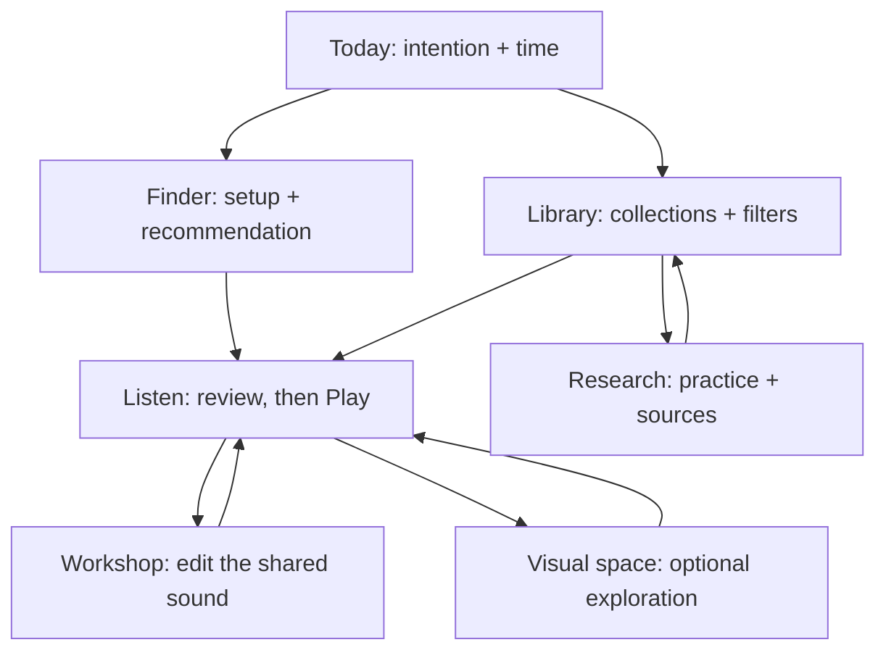

# Open Sync spatial experience — 15 October 2026

## Intent and boundaries

A quiet place to choose, understand and listen to sound, with explorable mathematical sculpture throughout the archive. The original master application stays at the root URL. This edition lives at `/archive/`, on `archive/dark-landscapes`. All 139 sounds, the seven-hour plans, hypnosis, research, original sand studio and specialist tools remain accessible. No deterministic DSP, live engine, session provider, safety governor or preview data is changed.

The graphics stack is React 19 + TypeScript + Three.js 0.186 + WebGL 2 + original GLSL shaders. Vite splits the renderer into a lazy chunk. A 4D object is represented mathematically and projected to 3D, then through a camera to the screen; it is not a separate physical display dimension. The visual is independent of audio and is never presented as a brain measurement or treatment.

## Primary-source design study

These are source-informed design judgments, not a ranking of the “best” sites or evidence of user outcomes. Artist/game imagery and implementation are not copied. The new category covers are original generated material studies; live sculpture is original code.

| Creator / work | Source inspected | Decision for Open Sync |
|---|---|---|
| Marc ten Bosch — Miegakure | [Creator's explanation](https://miegakure.com/), including slicing versus projection and gradual introduction of controls | Keep 3D/4D side by side. Reveal the fourth-axis control only in 4D. Explain that this app uses projection; Miegakure primarily uses slicing. Never make dimension manipulation a prerequisite for listening. |
| Marpi — Odra | [Artist project page](https://www.marpi.studio/exhibitions/odra), with credits to Stand & Marvel and Huncwot | Build one continuing visual environment around sound, with ordinary controls over it. Our geometry does not alter the sequencer or react to audio. |
| thatgamecompany — Journey | [Game's official page](https://thatgamecompany.com/journey/) | Use restrained landmarks, substantial negative space and an obvious next step. Avoid game scores, quests or reward loops in a meditation tool. |
| Matt Nava — The Art of Journey | [Publisher/developer announcement](https://thatgamecompany.com/the-art-of-journey-releases-in-september/) describing the art director's book | Treat palette, silhouette and spatial composition as a system. The book announcement was inspected; full-book access or a full reading is not claimed. |
| Bruno Imbrizi — Interactive Particles with Three.js | [Author's technical tutorial](https://tympanus.net/codrops/2019/01/17/interactive-particles-with-three-js/) | Use a shared vertex buffer and shader-driven particles, not thousands of DOM elements or individual meshes. Our shader and parameterization are original. |
| Three.js maintainers | [WebGLRenderer documentation](https://threejs.org/docs/pages/WebGLRenderer.html) | WebGL 2 support check, explicit resource disposal, capped pixel ratio and recoverable static art when rendering is unavailable. |

## Screen model and complete flow

The app has four primary tasks: arrive, choose, listen, understand. Workshop screens remain tools with stable deep links, not a second competing home. The existing navigation registry is the complete inventory, shared by More, Workshop, the command palette and the research directory.

| Surface | First decision / primary action | Secondary controls | State and recovery |
|---|---|---|---|
| Today | Take five minutes, or intention + available time | Four illustrated collection doors; overnight plan; sources; workshop | Loads the sound silently into Listen. Finder carries intention and minutes in the URL. |
| Presets | Collection, search, setup, duration, sound character | Group disclosures; preview; choose; details; evidence and category filters; sort; saved sounds | Existing URL state, preview limits, infant-mode filtering, empty recovery and panic remain. Details do not start playback. |
| Session finder | Intention, time and speakers/headphones | Experimental opt-in, recommendation reasons | Recommendation is transparent preset matching, not a health diagnosis. |
| Listen | Explicit Play / Pause / Resume / Stop | Volume, mute, remaining time, geometry, sand studio, Customize | Shared session survives navigation and visual changes. Edited-session note and start-block messages stay visible. |
| Visual space | 3D or 4D; camera zoom | Rotation, pause motion, reset, material, 4D angle, render detail, backdrop visibility | Sound status, pause/resume and hard stop remain reachable. Escape/Close returns focus. Panic closes this room so the existing stop overlay can be used. |
| Overnight | Intention + sound window + output setup | Continuous audio opt-in; theory and research; presets | Existing quiet-window defaults and duration/export limits remain. No sleep-stage sensing is implied. |
| Hypnosis / traditions / research | Read practice, then inspect sources | Related presets and tool directory | Original evidence grades and uncertainty remain next to claims. Geometry does not strengthen a claim. |
| Studio / harmonic / sound-method / frequency / sonic labs | Configure the sound artifact | Existing collapsible controls, phase editing, export, saved mixes, comparisons | Existing specialist rail remains collapsible; new Today → Workshop → current-page framing provides orientation and a return to Listen. |
| Cymatics / dream / sample / Nano / analyzer / other tools | Existing domain-specific action | Common visual-space entry, themes, command palette and full directory | No specialist visualization or mathematical model is replaced by the decorative field. |
| Guide / safety / project archives | Find help or review boundaries | Stable original-project links and full navigation | Switching apps still uses existing stop behavior. Master and frozen versions are retained. |

## Control model

- **Zoom − / +:** camera scale from 50% to 180%, in 10% steps, shared by both projections. Limits disable the corresponding button. The visible percentage updates immediately.
- **Reset view:** 100%, authored starting orbit and fourth-axis angle; keeps selected dimension, material and audio.
- **Rotate left/right:** keyboard and touch alternative to dragging. Dragging never captures wheel scrolling; touch still permits vertical page movement.
- **3D / 4D:** native buttons with pressed state. 4D enables an independently labelled fourth-axis slider in the expanded room.
- **Sculpture / Threads / Particles:** three views of the same mathematical surface, not different evidence or sound modes.
- **Pause visual motion:** affects graphics only. Sound transport is labelled separately.
- **Render detail:** Balanced caps 30 fps / DPR 1.5; Light caps 20 fps / DPR 1. Ambient rendering is capped at 20 fps.
- **Show geometry behind pages:** stops and releases the background renderer when off; the main visual room remains available.
- **Visual space / expand:** opens an accessible Radix modal. Close and stop remain in its sticky header. The underlying visuals pause while it is open.

## Composition and adaptation

Night Country uses ink, blue-green mineral light and pale sage; Quiet Horizon uses warm charcoal and sand. Their original full-viewport landscape paintings remain. New artwork supplies four practice doors: ivory torus, bronze knot, dark glass sphere, silver orbits. Art is decorative; all category names and actions are text.

Home moves from spacious art to a short listening path, a practical finder, collections, overnight and reading. Catalog filters sit on a stable solid surface; groups expand on request. Listen pairs one sculpture with one transport panel. Research uses a strong reading heading and restrained panels. Specialist controls share the same surfaces and orientation without changing their individual domain functions.

At narrow widths, hero and player stack; collections become two columns then one below 380px; camera buttons become 44px; advanced visual controls move below the sculpture. The immersive room scrolls vertically, with a sticky close/stop header and no horizontal drag requirement. Form controls use 16px text. Existing phone navigation and persistent stop remain. Actual device and assistive-technology checks are separate from DOM tests.

## Rendering and preservation contracts

- One persistent decorative renderer, plus a foreground field on Home/Listen or in the immersive room. Background and underlying fields pause when the room opens. No renderer per preset card.
- Reuse one indexed geometry and shader material for mesh and points; uniforms update without reconstructing GPU resources.
- Stop animation offscreen or while document-hidden. Start still when reduced motion is requested; users can explicitly animate. Theme changes redraw a paused field.
- Dispose renderer, geometry, material, observers and event handlers on unmount. Retry uses a fresh canvas after context failure. If WebGL 2 is absent, show the original still artwork and an honest status.
- Visual state uses registered versioned storage `open-sync:spatial.v1`, sanitized against malformed values. It cannot write the audio graph or saved presets.
- No autoplay audio, no external font/CDN runtime dependencies, no third-party assets, no extra heavy post-processing or ray tracing. These are intentional choices for an overnight listening use case.

## Review ledger

The following are sequential AI role perspectives, not independent human reviewers, licensed endorsement or observed user research.

| Pass / lens | Evidence and impact | Accepted change / owner | Acceptance |
|---|---|---|---|
| Baseline / interaction | Browser + code at 84413cb: geometry has turn/dimension buttons but no camera zoom; state resets on route changes | Shared spatial provider, bounded zoom, reset; local implementation | Both projections zoom, limits work, settings persist across routes |
| Baseline / art direction | Browser: thin wireframe isolated to two screens; most surfaces retain previous framing | GPU sculpture, common backdrop/material system, original collection art | Live shader in home/player; visual-space entry on any archive route |
| Baseline / cognition | Code: discovery and specialist tools have different orientation conventions | Preserve working rail, add explicit workspace journey and return to listening | No tool removed; all routes still in directory; no extra hub required |
| Candidate / accessibility | Code: pointer orbit needs non-gesture path; new room could obscure stop | Native camera buttons, range label, Radix focus trap, sticky close/stop, close on panic | Keyboard controls, no audio side effects, panic cuts and exits room |
| Candidate / performance | Code: repeated animation initialization and high-DPR risk | Lazy Three chunk, stable resources, capped frame/DPR, visibility pause, still fallback | Lifecycle and fallback checks, live console review; no device endurance claim |
| Candidate / domain practice | Existing sourced content separates evidence from artistic/experimental claims | Keep scientific copy, sound presets and engine unchanged; explain geometry | Full existing regression suite remains a release gate |
| Release / moderator | Automated and live evidence recorded in `.design/spatial-verification.md` | Fix observed blockers before declaring release verified | Passing full gate and actual deployed route checks |

Rejected: 3D-only navigation, changing audio with camera gestures, continuous 60 fps full-resolution shaders, copying game assets, claiming that 4D graphics cause altered states, and replacing working sound tools solely to change the framework.
